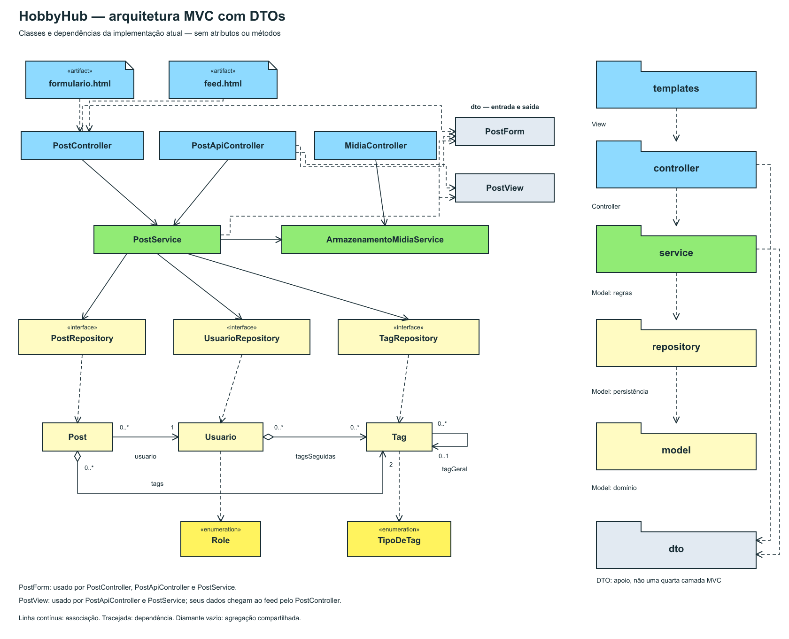
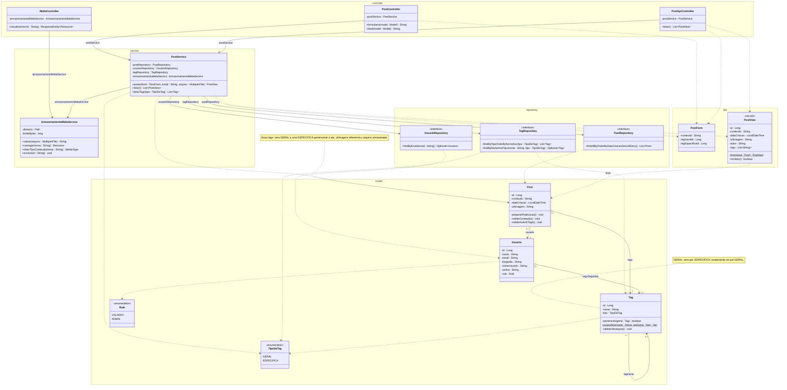
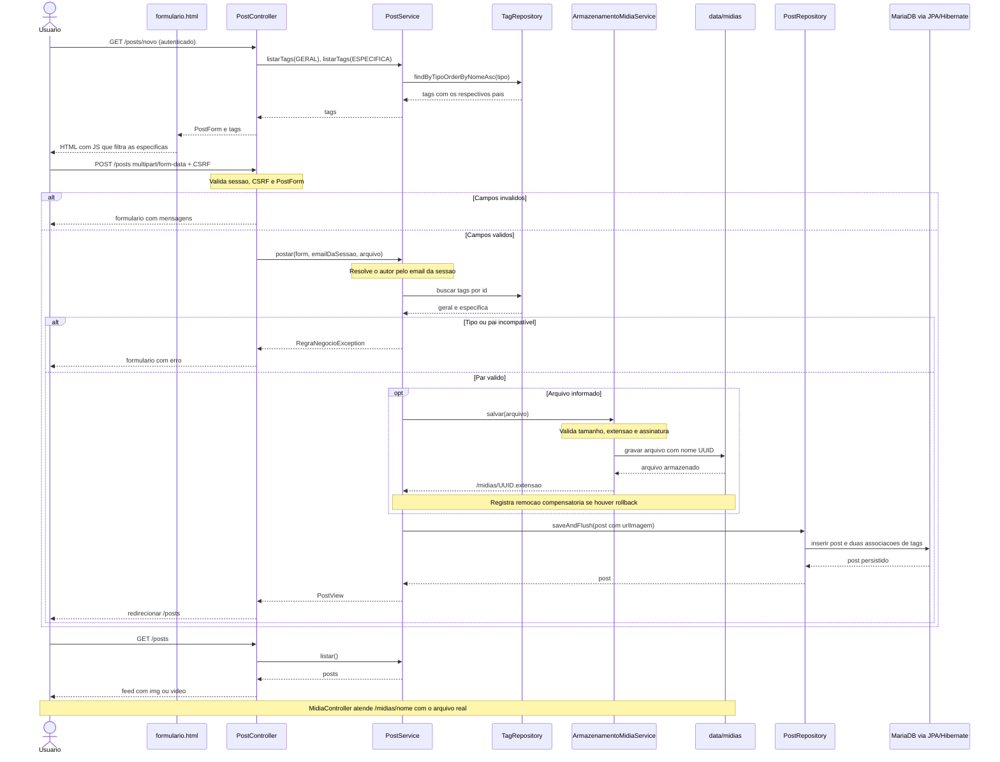

# HobbyHub: arquitetura MVC e UC05 — Postar

A aplicação é um único projeto Spring Boot. O front-end não exige um servidor separado: Thymeleaf processa o HTML e Spring MVC entrega HTML, CSS e JavaScript ao navegador.

## Desenho da arquitetura
## Arquitetura simplificada com DTOs

O desenho principal agora apresenta apenas os nomes das classes, sem atributos ou operações. Inclui PostForm e PostView no pacote dto, com dependências de uso dos controllers e PostService. O pacote dto é apoio de entrada/saída e não uma quarta camada MVC. A dependência de PostController para PostView não foi desenhada porque esse controller não referencia o tipo explicitamente: recebe a lista devolvida pelo service e a coloca no Model do Spring.

Mermaid deste recorte: [arquitetura.mmd](arquitetura.mmd). A View é representada no SVG pelos artefatos formulario.html e feed.html, não por classes fictícias. Inicialização, configuração e classes auxiliares de tratamento de erros foram omitidas neste recorte, como na referência; continuam no diagrama completo da implementação. As notas e multiplicidades detalhadas seguem nos diagramas de classes.

Restrições mantidas: o post tem uma tag geral e uma específica pertencente a ela; tag geral não tem pai e específica tem exatamente um pai geral.

Versão vetorial para ampliar e imprimir: [arquitetura.svg](arquitetura.svg).

A versão SVG usa símbolos de pacotes UML com abas, artefatos para os templates, classificadores de classe/interface e as relações do domínio, seguindo a disposição e as cores da referência fornecida. É um recorte: Configuração e tratamento de exceções são descritos abaixo e no diagrama completo da implementação. As setas tracejadas à direita são dependências entre pacotes; não representam a sequência de execução. A dependência template/controller indica o uso dos endpoints pelos formulários e links, mediado por HTTP e Spring MVC.

## Responsabilidades e diretórios

| Parte | Diretório | Responsabilidade |
| --- | --- | --- |
| View | src/main/resources/templates | login.html, formulario.html, feed.html e fragmentos Thymeleaf |
| Recursos da View | src/main/resources/static | CSS e JavaScript que filtra as tags específicas |
| Controller | src/main/java/br/com/hobbyhub/controller | HTTP, validação de entrada, chamada do service, views e respostas JSON/arquivos |
| Model: regras | src/main/java/br/com/hobbyhub/service | PostService valida a publicação; ArmazenamentoMidiaService gerencia os arquivos |
| Model: persistência | src/main/java/br/com/hobbyhub/repository | Interfaces Spring Data JPA; papel de acesso a dados equivalente ao DAO da referência |
| Model: domínio | src/main/java/br/com/hobbyhub/model | Post, Usuario, Tag, Role e TipoDeTag |
| Contratos | src/main/java/br/com/hobbyhub/dto | PostForm recebe campos; PostView devolve apenas dados necessários à tela/API |
| Configuração | src/main/java/br/com/hobbyhub/config | Segurança, conta e tags de demonstração |
| Dados em execução | schema hobbyhub no MariaDB e data/midias | Banco externo e arquivos enviados; ficam fora do código-fonte |

No MVC do Spring, Controller é o controller HTTP; regras em services pertencem ao Model. Não usamos Bean JSF ou XHTML porque nossa tecnologia de apresentação é Thymeleaf. O diagrama de referência inspira a organização visual, mas os nomes e responsabilidades correspondem ao projeto atual.

## Diagrama de classes de projeto em Mermaid

Leitura UML:

- Associação navegável: linha contínua com seta aberta. Nas classes, as referências por associação foram mostradas pelos papéis nas linhas; alguns campos de infraestrutura também aparecem no compartimento para facilitar a leitura.
- Dependência: linha tracejada com seta aberta.
- Agregação compartilhada: diamante vazio no lado de Post e Usuario, preservando o modelo aprovado. Tags podem ser compartilhadas e não são removidas em cascata.
- Post tem exatamente um Usuario e duas Tags. Um usuário e uma tag podem estar associados a zero ou muitos posts.
- A nova associação Tag → Tag usa 0..1 no papel tagGeral. A restrição condicional especifica: tag GERAL não tem pai; tag ESPECIFICA tem exatamente um pai GERAL. Uma tag geral pode ser pai de zero ou muitas específicas. É uma associação simples, não composição.
- Cada repository estende uma especialização de JpaRepository, omitida do recorte por ser infraestrutura externa. A implementação é criada pelo Spring Data.
- Os namespaces do Mermaid agrupam as classes pelos pacotes, mas não exibem os símbolos de abas de um diagrama de pacotes UML. Esses símbolos estão no SVG.
- record é um estereótipo de implementação Java, não um estereótipo padronizado UML. Métodos auxiliares, construtores e acessores gerados por Lombok foram parcialmente omitidos. Long permite id nulo antes de persistir, refinando o long do modelo conceitual.

## O que mudou em relação aos diagramas aprovados

A relação pai/filha de Tag foi acrescentada a pedido nesta revisão. Ela altera o modelo aprovado; deve constar da versão apresentada ao professor. O restante preserva as classes e agregações de domínio. urlImagem continua sendo String e permanece no Post: agora a aplicação gera seu valor após receber o arquivo, como referência ao local de armazenamento. O nome foi mantido por compatibilidade com o diagrama; a propriedade também referencia vídeos nesta entrega.

## Fluxo de publicação

## Upload e persistência

O campo arquivo é um MultipartFile recebido por HTTP; não é uma entidade nem um atributo persistido de Post. O service valida as tags antes de gravar a mídia. O armazenamento aceita JPG/JPEG, PNG, GIF, WEBP, MP4 e WEBM, até 25 MB, verificando extensão e assinatura inicial do conteúdo. Não confia no nome/MIME enviado pelo navegador para definir o tipo servido.

O arquivo recebe nome aleatório UUID e é gravado em data/midias. O banco armazena apenas uma referência relativa /midias/UUID.extensao em urlImagem. MidiaController entrega o arquivo para usuários autenticados, incluindo requisições HTTP Range para vídeo. O feed usa img para imagens e video com controls para vídeos.

Imagem/vídeo são opcionais; um post pode conter apenas texto e tags. O conteúdo deve ter de 1 a 2000 caracteres e as tags devem existir e formar um par válido. O formulário filtra as específicas pelo pai; o servidor valida novamente a relação. Se o formulário falhar, os textos e tags são preservados; o navegador exige escolher o arquivo novamente. Arquivos acima do limite recebem HTTP 413 e mensagem própria.

Banco e sistema de arquivos não compartilham uma transação atômica. Uma falha de transação dispara remoção compensatória da mídia; arquivos temporários também são removidos. Encerramento abrupto do processo entre gravação em disco e conclusão do banco ainda pode deixar um arquivo órfão. Isso não foi resolvido com uma rotina de reconciliação nesta primeira implementação.

A verificação de assinatura é básica, não uma decodificação completa, antivírus ou transcodificação. A reprodução de vídeos depende do codec suportado pelo navegador. O teste de vídeo verifica upload, referência, player no HTML e HTTP Range com cabeçalho sintético; não confirma reprodução de um vídeo real.

## Banco criado pela primeira versão

Hibernate acrescenta a coluna tag_geral_id. DadosIniciais vincula Futebol a Esporte, Pintura a Arte e Programação a Tecnologia, inclusive quando as seis tags já existem. O banco não é apagado e os posts antigos são preservados. A nova validação se aplica às novas publicações; posts antigos com combinações incompatíveis não são reescritos. Tags antigas adicionais sem pai exigiriam uma migração específica; não há interface administrativa de tags nesta entrega.

## Escopo e verificação

Cadastro, perfis e manutenção administrativa continuam fora do escopo. Leia validacao.md para o resultado efetivamente executado. Os testes usam um schema temporário exclusivo no MariaDB e mídia sob target; a verificação HTTP usa banco e arquivos de teste separados do diretório data.
