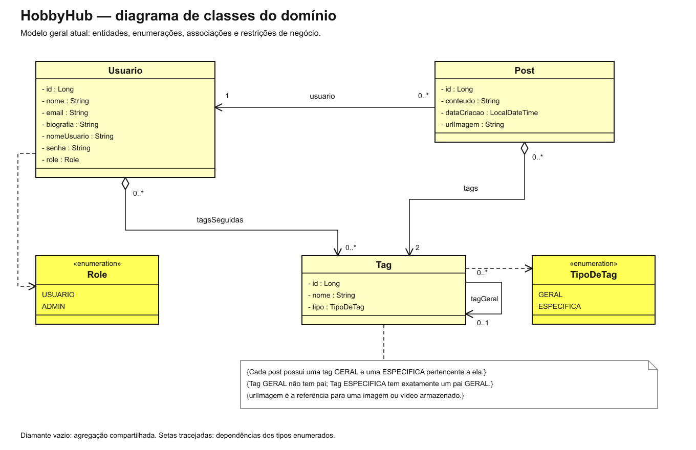
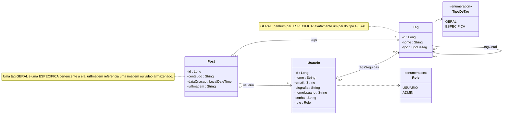
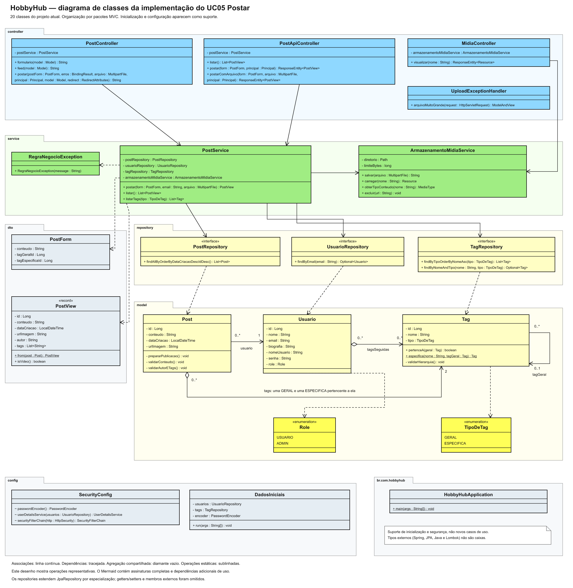

# Diagramas de classes do HobbyHub

## 1. Diagrama geral do domínio

Modelo geral do HobbyHub, no estilo da referência: classes com atributos, enumerações, papéis e multiplicidades. São as entidades do sistema já definido, sem criar classes para funcionalidades futuras: Usuario, Post, Tag, Role e TipoDeTag. Admin é um valor de Role; não é uma subclasse de Usuario. O arquivo de mídia é referenciado por urlImagem; não foi inventada uma entidade Midia.

Arquivos: [SVG vetorial](diagrama-classes-geral.svg) · [PNG](diagrama-classes-geral.png) · [Mermaid editável](diagrama-classes-geral.mmd).

## 2. Diagrama de classes da implementação do UC05 — Postar

Contém exatamente as 20 classes Java existentes atualmente em src/main/java, organizadas conforme a arquitetura: controller, service, repository, dto, model, config e o pacote raiz br.com.hobbyhub. O fluxo de publicação e seus apoios já implementados aparecem juntos. DadosIniciais, SecurityConfig e HobbyHubApplication ficam identificados como suporte de configuração/inicialização, sem sugerir que são passos executados a cada postagem.

Arquivos: [SVG vetorial](diagrama-classes-uc05.svg) · [PNG](diagrama-classes-uc05.png) · [Mermaid editável](diagrama-classes-uc05.mmd).

O SVG privilegia a leitura visual com operações representativas e associações principais. O Mermaid inclui dependências adicionais entre as classes e assinaturas completas dos métodos de publicação. Em ambos, getters/setters de Lombok, alguns construtores e métodos auxiliares foram omitidos. Os tipos de bibliotecas externas aparecem nas assinaturas, mas não como novas classes do projeto.

```mermaid
classDiagram
    direction TB

    namespace controller {
        class PostController {
            -postService : PostService
            +formulario(model : Model) String
            +feed(model : Model) String
            +postar(postForm : PostForm, erros : BindingResult, arquivo : MultipartFile, principal : Principal, model : Model, redirect : RedirectAttributes) String
        }
        class PostApiController {
            -postService : PostService
            +listar() List~PostView~
            +postar(form : PostForm, principal : Principal) ResponseEntity~PostView~
            +postarComArquivo(form : PostForm, arquivo : MultipartFile, principal : Principal) ResponseEntity~PostView~
        }
        class MidiaController {
            -armazenamentoMidiaService : ArmazenamentoMidiaService
            +visualizar(nome : String) ResponseEntity~Resource~
        }
        class UploadExceptionHandler {
            +arquivoMuitoGrande(request : HttpServletRequest) ModelAndView
        }
    }

    namespace service {
        class PostService {
            -postRepository : PostRepository
            -usuarioRepository : UsuarioRepository
            -tagRepository : TagRepository
            -armazenamentoMidiaService : ArmazenamentoMidiaService
            +postar(form : PostForm, email : String, arquivo : MultipartFile) PostView
            +listar() List~PostView~
            +listarTags(tipo : TipoDeTag) List~Tag~
        }
        class ArmazenamentoMidiaService {
            -diretorio : Path
            -limiteBytes : long
            +salvar(arquivo : MultipartFile) String
            +carregar(nome : String) Resource
            +obterTipoConteudo(nome : String) MediaType
            +excluir(url : String) void
        }
        class RegraNegocioException {
            +RegraNegocioException(message : String)
        }
    }

    namespace repository {
        class PostRepository {
            <<interface>>
            +findAllByOrderByDataCriacaoDescIdDesc() List~Post~
        }
        class UsuarioRepository {
            <<interface>>
            +findByEmail(email : String) Optional~Usuario~
        }
        class TagRepository {
            <<interface>>
            +findByTipoOrderByNomeAsc(tipo : TipoDeTag) List~Tag~
            +findByNomeAndTipo(nome : String, tipo : TipoDeTag) Optional~Tag~
        }
    }

    namespace dto {
        class PostForm {
            -conteudo : String
            -tagGeralId : Long
            -tagEspecificaId : Long
        }
        class PostView {
            <<record>>
            -id : Long
            -conteudo : String
            -dataCriacao : LocalDateTime
            -urlImagem : String
            -autor : String
            -tags : List~String~
            +from(post : Post) PostView$
            +isVideo() boolean
        }
    }

    namespace model {
        class Post {
            -id : Long
            -conteudo : String
            -dataCriacao : LocalDateTime
            -urlImagem : String
            -prepararPublicacao() void
            -validarConteudo() void
            -validarAutorETags() void
            -obterTag(tipo : TipoDeTag) Tag
        }
        class Usuario {
            -id : Long
            -nome : String
            -email : String
            -biografia : String
            -nomeUsuario : String
            -senha : String
            -role : Role
        }
        class Tag {
            -id : Long
            -nome : String
            -tipo : TipoDeTag
            +pertenceA(geral : Tag) boolean
            +especifica(nome : String, tagGeral : Tag) Tag$
            -validarHierarquia() void
        }
        class Role {
            <<enumeration>>
            USUARIO
            ADMIN
        }
        class TipoDeTag {
            <<enumeration>>
            GERAL
            ESPECIFICA
        }
    }

    namespace config {
        class SecurityConfig {
            ~passwordEncoder() PasswordEncoder
            ~userDetailsService(usuarios : UsuarioRepository) UserDetailsService
            ~securityFilterChain(http : HttpSecurity) SecurityFilterChain
        }
        class DadosIniciais {
            -usuarios : UsuarioRepository
            -tags : TagRepository
            -encoder : PasswordEncoder
            +run(args : String[]) void
            -criarUsuarioDemo() void
            -obterOuCriarGeral(nome : String) Tag
            -vincularEspecifica(nome : String, geral : Tag) void
        }
    }

    class HobbyHubApplication {
        +main(args : String[]) void$
    }

    PostController --> PostService : postService
    PostApiController --> PostService : postService
    MidiaController --> ArmazenamentoMidiaService : armazenamentoMidiaService
    PostService --> PostRepository : postRepository
    PostService --> UsuarioRepository : usuarioRepository
    PostService --> TagRepository : tagRepository
    PostService --> ArmazenamentoMidiaService : armazenamentoMidiaService
    PostController ..> PostForm
    PostApiController ..> PostForm
    PostApiController ..> PostView
    PostService ..> PostForm
    PostService ..> PostView
    PostService ..> Post
    PostService ..> TipoDeTag
    PostRepository ..> Post
    UsuarioRepository ..> Usuario
    TagRepository ..> Tag
    TagRepository ..> TipoDeTag
    PostView ..> Post : from
    Post "0..*" --> "1" Usuario : usuario
    Post "0..*" o--> "2" Tag : tags
    Usuario "0..*" o--> "0..*" Tag : tagsSeguidas
    Tag "0..*" --> "0..1" Tag : tagGeral
    PostController ..> RegraNegocioException
    PostApiController ..> RegraNegocioException
    PostService ..> RegraNegocioException
    ArmazenamentoMidiaService ..> RegraNegocioException
    SecurityConfig ..> UsuarioRepository
    SecurityConfig ..> Usuario
    SecurityConfig ..> Role
    DadosIniciais --> UsuarioRepository : usuarios
    DadosIniciais --> TagRepository : tags
    DadosIniciais ..> Usuario
    DadosIniciais ..> Tag
    DadosIniciais ..> Role
    DadosIniciais ..> TipoDeTag
    PostService ..> Usuario
    PostService ..> Tag
    PostController ..> TipoDeTag
    Usuario ..> Role
    Tag ..> TipoDeTag
    note for Tag "GERAL: sem pai. ESPECIFICA: exatamente um pai GERAL."
    note for Post "Duas tags: uma GERAL e uma ESPECIFICA pertencente a ela. urlImagem referencia o arquivo armazenado."
```

## Correspondência à arquitetura

| Pacote | Classes existentes | Papel |
| --- | --- | --- |
| controller | PostController, PostApiController, MidiaController, UploadExceptionHandler | Controller: entradas HTTP, renderização/respostas e tratamento de upload excessivo |
| service | PostService, ArmazenamentoMidiaService, RegraNegocioException | Model: regras de postagem, armazenamento e sinalização de falha de negócio |
| repository | PostRepository, UsuarioRepository, TagRepository | Model: persistência com Spring Data JPA |
| dto | PostForm, PostView | Dados de entrada e saída dos controllers/services |
| model | Usuario, Post, Tag, Role, TipoDeTag | Model: domínio |
| config | SecurityConfig, DadosIniciais | Suporte: segurança e dados iniciais |
| br.com.hobbyhub | HobbyHubApplication | Inicialização da aplicação |

A View permanece em src/main/resources/templates, com CSS/JavaScript em static. HTML e recursos são artefatos; não são classes Java fictícias no diagrama de classes. A arquitetura anterior continua documentada em [arquitetura.md](arquitetura.md).

## Leitura UML

- Linha contínua com seta aberta: associação navegável. As referências injetadas dos controllers e service são associações. No diagrama de projeto, alguns campos também são mostrados para facilitar a correspondência ao código; o campo e a linha descrevem a mesma propriedade, não duas relações diferentes.
- Diamante vazio: agregação compartilhada, preservada do modelo aprovado para Post.tags e Usuario.tagsSeguidas. Não há composição nem remoção em cascata de tags.
- Linha tracejada com seta aberta: dependência de uso. Role e TipoDeTag são tipos de propriedades, exibidos no compartimento de atributos; as linhas tracejadas não representam objetos independentes possuídos pelo usuário/tag.
- As propriedades usuario, tags, tagsSeguidas e tagGeral são representadas por papéis de associação, evitando repetir seus atributos no domínio.
- Post → Usuario: um autor por post; um usuário pode ter zero ou muitos posts.
- Post → Tag: exatamente duas tags por post; uma tag pode participar de zero ou muitos posts. Restrição adicional: uma GERAL e uma ESPECIFICA pertencente àquela GERAL.
- Usuario → Tag: zero ou muitas tags seguidas por usuário; uma tag pode ser seguida por zero ou muitos usuários.
- Tag → Tag: a propriedade tagGeral tem multiplicidade 0..1 no conjunto de todas as tags. A restrição condicional exige nenhum pai para GERAL e exatamente um pai GERAL para ESPECIFICA. A associação é simples, sem composição/agregação. As notas são restrições em linguagem natural, não OCL formal.
- Enumerações têm literais USUARIO/ADMIN e GERAL/ESPECIFICA; eles não são atributos privados do tipo int.
- Long refina o long do modelo conceitual para permitir id nulo antes da persistência. LocalDateTime e urlImagem foram mantidos conforme o código.
- Operações estáticas aparecem sublinhadas no SVG e com marcador de estático no Mermaid. ~ indica visibilidade de pacote, usada nos métodos @Bean de SecurityConfig.
- record é um estereótipo tecnológico Java, não um estereótipo padrão da UML. Os namespaces do Mermaid são agrupamentos por pacote; o SVG usa as abas de pacote UML.
- PostRepository, UsuarioRepository e TagRepository estendem especializações de JpaRepository. A superinterface externa foi omitida por escopo, assim como RuntimeException, superclasse externa de RegraNegocioException, e CommandLineRunner, interface externa realizada por DadosIniciais. Não foram inventadas implementações concretas dos repositories; o Spring Data as fornece em execução.

## Verificação

Os nomes das 20 classes do diagrama de implementação foram comparados à lista real de arquivos Java. Os atributos e operações mostrados foram conferidos nos fontes. Os dois Mermaid foram submetidos ao parser, e os SVGs foram renderizados para inspeção visual. Validação de sintaxe Mermaid e revisão de símbolos não equivalem à verificação formal do metamodelo UML.

Esta entrega altera somente documentação e desenhos. A relação entre tag específica e geral já estava implementada e foi preservada nos dois diagramas. Ela é a evolução do modelo anteriormente aprovado, decidida na revisão anterior.
